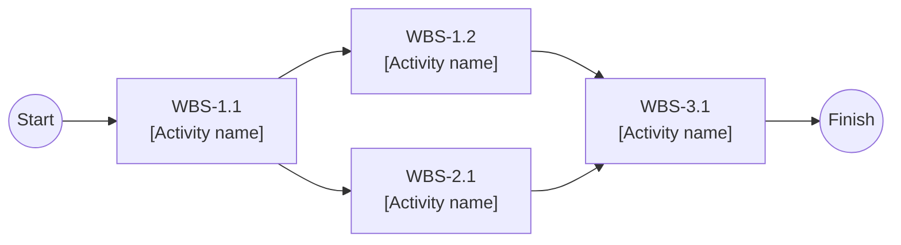
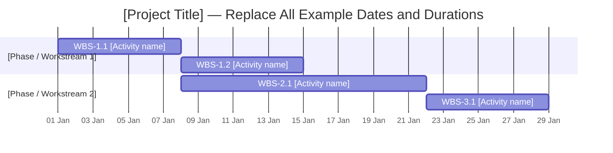

# Software Engineering — Project Plan

## Cover Page

| Field | Details |
|---|---|
| **Course** | BLG411E — Software Engineering |
| **Report name** | Project Plan |
| **Project title** | Epilogos — Intelligent Post-Meeting Workflow Platform |
| **Group name / number** | 4 Bytes |
| **Group members** | Furkan Kural — 150210056, İlke Başak Baydar — 150140709, Muhammed Yunus Doğru — 150210092, Mehmet Enes Tekgöz — 150210089, Abdul Akhundzada — 150220926 |
| **Instructor** | Ayşe Tosun Kühn, Tolga Ovatman |
| **Submission date** | 2026-10-25 |
| **Document version** | 1.0 |

---

## 1. Introduction

### 1.1 Scope

**Project overview:**  
Engineering teams make many technical decisions and assign many follow-up tasks during architecture reviews, sprint plannings and technical syncs. These outcomes are usually captured manually, if at all, and a significant part of them never reaches the team's backlog. Epilogos is a web platform for agile software teams and engineering managers. A user uploads a recorded meeting, and the system produces a timestamped transcript with speaker labels. It then extracts the decisions and action items as schema-validated structured items and lets the user review and approve them. Approved items are exported to Atlassian Jira as tasks and sub-tasks in one click.

**In scope:**
- **Media ingestion & asynchronous processing:** Upload of MP4, MKV and WAV recordings, background job orchestration (Celery + Redis), queue management and job progress tracking.
- **Speaker-attributed transcription:** Timestamped transcripts with speaker labels, produced with faster-whisper and pyannote.audio. Speaker identity is scoped to a single meeting, and users can rename labels such as "Speaker 1".
- **Core inference engine:** A self-hosted vLLM server running Qwen 2.5 3B Instruct (local mode) and an OpenAI-compatible cloud adapter (cloud mode). The active mode is selected through configuration (`.env`).
- **Action item & decision extraction:** LLM-based parsing of transcripts into structured items (title, assignee, description, priority), with strict Pydantic schema validation via Instructor.
- **Human review step:** users edit, approve or reject extracted items before export.
- **Atlassian Jira integration:** One-way creation of Jira tasks and sub-tasks from approved items via the Jira Cloud REST API.
- **Synchronized playback interface:** A web dashboard that pairs audio/video playback with an interactive transcript. Clicking a transcript line seeks the player to that timestamp.
- **Data protection:** JWT authentication, role-based access control (RBAC), encrypted storage of Jira credentials, and a PII masking engine that masks secrets and personal data (tokens, API keys, passwords, e-mail addresses) before any text reaches an LLM or Jira.
- **Dual-mode deployment:** A local-first Docker Compose deployment, and a live cloud deployment with a public URL for demonstration.

**Optional scope:**
- Turkish-language meeting support.
- Export of a meeting summary (decisions and action items) as Markdown or PDF.
- Full-text search across past meetings' transcripts and decisions.
- In-app or e-mail notification when processing finishes.

**Out of scope:**
- Live call bots that join Zoom, Google Meet or MS Teams calls and real-time or streaming transcription.
- Biometric speaker enrollment and cross-meeting speaker identity databases.
- Two-way Jira synchronization (status changes in Jira are not mirrored back to Epilogos).
- Speaker diarization in cloud mode (see the deployment architecture below).
- Paid, always-on production hosting, native mobile applications and issue trackers other than Jira.

**Architecture and technology decisions:**

- **AI-assisted development tools:** Claude Code and Cursor / Antigravity. They generate boilerplate code, UI templates, test skeletons and first drafts of documentation and reports. They are not part of the product and all their output is reviewed by a team member through a pull request.
  - **AI usage tracking & transparency:** To satisfy course reporting requirements on AI tool usage, the team follows a structured protocol for documenting core system prompts and AI-assisted architectural decisions. While raw iterative prompts are kept local and excluded from version control via .gitignore, summarized markdown logs and reports of major AI interactions are maintained within the docs/ai-prompts/ directory when needed for course submissions. Each team member tracks estimated time saved and reviews all AI-generated code/text via pull requests.
  - **Key prompt log:** In addition, the prompts that led to fundamental changes in the code or documents (e.g., architecture, database schema or major refactoring) are kept in a separate log, apart from the general interaction logs, together with a link to the pull request they produced. This log is used as the source for the AI-usage sections of the course reports.
- **Core product AI engine:** the AI that runs inside Epilogos. It has three parts:
  - **Speech:** faster-whisper for speech-to-text and pyannote.audio for diarization.
  - **Extraction:** An LLM accessed through an OpenAI-compatible interface (Instructor + Pydantic).
  - **Inference engine (local mode):** vLLM. It was chosen for its high throughput, efficient memory management (PagedAttention) and OpenAI-compatible API, which lets the same client code run against local and cloud back-ends.

*Model selection & cloud flexibility:*
- **Local Mode:** Qwen 2.5 3B Instruct (4-bit AWQ) is configured to guarantee reliable structured Pydantic extraction while fitting within consumer GPU VRAM alongside faster-whisper and pyannote.audio.
- **Cloud Mode:** Heavy inference is offloaded via OpenAI-compatible endpoints (Groq, OpenRouter, etc.), allowing seamless configuration of larger hosted models (e.g., Qwen 3.8 27B or equivalent high-capability open models) without any code modifications.
- **Configuration-based choice:** The model name, API key, endpoint and mode are strictly managed via `.env`.

*Dual-mode deployment (`INFERENCE_MODE`):*
- **Local mode (`INFERENCE_MODE=local`) — primary, local-first, zero-trust.**
  - The full stack runs with Docker Compose on a machine with a consumer GPU: FastAPI, PostgreSQL, Redis, Celery workers, vLLM (Qwen 2.5 3B), faster-whisper and pyannote.audio.
  - No meeting data leaves the machine. This mode is used for development and for privacy-sensitive use.
- **Cloud mode (`INFERENCE_MODE=cloud`) — live demo with a public URL at $0 budget.**
  - **Hosting:** the platform is deployed on Render's free tier. Render offers no free background-worker instance type, so the cloud deployment runs the FastAPI application and an embedded Celery worker inside a single free web service (512 MB RAM).
  - **Inference:** heavy inference is delegated to free OpenAI-compatible cloud APIs, namely Groq (Whisper large-v3 for transcription and a hosted open model for extraction) or OpenRouter as an alternative.
  - **Model flexibility:** While local mode uses Qwen 2.5 3B Instruct to respect GPU VRAM limits, cloud mode leverages free OpenAI-compatible endpoints (Groq / OpenRouter) to call higher-parameter hosted models (such as Qwen 2.5 32B/72B or Llama 3.3 70B) without local VRAM constraints. The Instructor extraction schemas, Pydantic validation rules, and prompts remain identical across both modes.
  - **No diarization:** pyannote.audio does not fit in the free cloud instance, so cloud-mode transcripts have no speaker labels. The demo therefore also shows meetings processed in local mode.
  - **Queue broker:** Redis runs on Render's free Key Value instance (25 MB, no persistence). Queued jobs can be lost if the instance restarts, so cloud mode is used only for short demo recordings and the user can re-submit a failed job.
  - **Free-tier limits:** free cloud instances sleep when idle, have ephemeral disks, and the free managed PostgreSQL expires after 30 days. Uploaded media is therefore stored only temporarily, and the cloud database is created during W6 so that it remains available through the demo and the final presentation.
- **PII privacy layer.** In both modes, transcripts pass through the PII masking engine (T-07) *before* they reach the LLM layer. In cloud mode the masking runs inside the Epilogos backend before any extraction request is sent. API keys, passwords, e-mail addresses and personal data therefore never reach an external LLM in unmasked form.
- **Limit of the cloud-mode guarantee.** In cloud mode the audio itself is sent to the cloud speech-to-text provider. Full zero-leakage is therefore guaranteed only in local mode. Cloud mode is intended for the live demo with non-sensitive sample meetings.

*Backend & frontend architecture — monolith:*
- The application is a **FastAPI monolith** with server-rendered **Jinja2/HTML templates**, styled with Tailwind CSS and using lightweight JavaScript for the synchronized player.
- This decision reduces project complexity: it removes cross-origin (CORS) configuration, a second build toolchain and a separate frontend deployment.
- **Service-based design with a separate presentation layer:** all business functions (upload, job status, transcripts, item review, Jira export) are exposed as documented REST endpoints (OpenAPI). The frontend is a separate presentation layer inside the same deployment: Jinja2 renders the pages, and the player, progress and review screens call the REST API from JavaScript. The API can therefore be used by other clients without changes.
- **Change from the Project Charter:** this replaces the separate Next.js frontend listed in the charter. The change is recorded in the charter revision.
- **Portability:** the system is container-native. It runs locally with Docker Compose (local-first portability) and is cloud-ready for Render.

*Database (PostgreSQL) rationale:*
- **Strict relational hierarchy:** the data forms a foreign-key chain (Users → Meetings → Transcripts → Action Items → Jira issue keys), with cascading integrity rules.
- **Pydantic alignment:** a typed relational schema maps cleanly to Pydantic and SQLAlchemy models.
- **Native JSONB:** semi-structured data (raw model outputs, extraction metadata, pipeline configuration) is stored without a separate document store.
- **Async performance:** the asyncpg driver gives high-performance asynchronous access from FastAPI.

*Concurrency and queue management:*
- **Local mode:**
  - GPU-bound tasks (transcription, diarization, LLM extraction) run on a dedicated Celery queue with `concurrency=1` and `prefetch_multiplier=1`, to prevent VRAM conflicts on a single consumer GPU.
  - Simultaneous uploads wait in the Redis queue and are processed sequentially. Users see their queue position and progress.
  - I/O-bound tasks (uploads, Jira export) run on a separate queue.
- **Cloud mode:** worker rate limits are set below the free-tier limits of the cloud APIs, and requests that hit a rate limit are retried with exponential backoff.

**Assumptions and constraints:**
- **Team:** five students taking other courses in parallel. Each member is planned at **0.5 FTE (≈20 h/week)**, split into **0.4 FTE for development** and **0.1 FTE for course documentation**.
- **Time:** the schedule is fixed by the course. Development runs from 2026-10-26 until the **code freeze on 2026-12-25**, the demo is on 2026-12-26 and the final presentation on 2026-12-28. The intermediate report deadlines are fixed milestones.
- **Exam weeks:** the BLG411E midterm is on 2026-11-23 (W5), in the same week as the Requirements Analysis deadline, and other courses' midterms fall around W3–W5. This is expected to reduce effective availability below the planned 0.5 FTE. The buffer for this is described in Section 4.2 and in R-10.
- **Customer communication & meetings:** Formal customer meetings with the course teaching assistant are scheduled approximately every 2 weeks (as determined by TA). Day-to-day clarifications, scope questions, and feedback are handled asynchronously via GitHub issues/comments and the team's WhatsApp group.
- **Budget:** zero monetary budget. The project uses open-source and open-weight models, free cloud tiers (Render, Groq/OpenRouter, Jira Cloud Free) and free datasets.
- **Hardware:**
  - Local mode assumes a consumer GPU with roughly 8–12 GB of VRAM.
  - VRAM is managed by capping vLLM's GPU memory reservation (`gpu_memory_utilization`), using an AWQ-quantized LLM and int8 faster-whisper, and processing jobs sequentially, so that the speech models and the LLM do not exhaust GPU memory together.
- **Input:** meetings are primarily in English and are uploaded after they end. A single recording is at most 90 minutes and 1 GB. In cloud mode, audio is compressed and/or split into chunks before transcription to stay within the provider's file-size limit.
- **Benchmark datasets** (open meeting corpora, used for quality measurement):
  - **AMI Meeting Corpus** and **ICSI Meeting Corpus:** transcription accuracy (WER) and diarization quality (DER) on multi-speaker meetings.
  - **QMSum** and **MeetingBank:** quality of summaries and extracted items.
  - **AMI's manual summaries** of decisions and actions: reference for evaluating the action items and decisions produced by the LLM.
- **Test-first approach (course practice):** acceptance tests are derived from the Gherkin acceptance criteria of the user stories while the requirements are written (WBS-13.1). For deterministic modules (API endpoints, auth/RBAC, masking rules, speaker alignment, Jira field mapping), tests are written from each activity's "Done when" condition before the implementation, and a PR is merged only with its tests. Model-based stages (transcription, diarization, LLM extraction) are verified against reference recordings and expected-output ranges, with the LLM and Jira mocked in unit tests. QA/DevOps leads the test infrastructure, CI integration and end-to-end tests.

### 1.2 Deliverables

| Deliverable ID | Deliverable name | Description / contents | Acceptance criterion |
|---|---|---|---|
| D-01 | Backend Core & Async Processing Service | FastAPI monolith (REST API + server-rendered pages), SQLAlchemy/asyncpg data-access layer, Celery/Redis job orchestration with separate GPU and I/O queues, media upload and job status endpoints, OpenAPI documentation. | Runs in Docker. A valid MP4/MKV/WAV upload creates a job that is queued and processed in the background. The status endpoint reports every stage and the queue position. Integration tests pass in CI. |
| D-02 | Speech Processing Pipeline | FFmpeg preprocessing, faster-whisper transcription, pyannote.audio diarization, alignment of text segments with speaker labels, and a cloud-mode transcription adapter. | On at least 3 sample recordings it produces a persisted, timestamped, speaker-labelled transcript (local mode) without manual intervention. WER (jiwer) and DER are measured and reported on an AMI/ICSI subset. |
| D-03 | Core Inference Engine & Extraction Module | vLLM server configuration with Qwen 2.5 3B Instruct (AWQ), cloud adapter, `.env`-based mode and model switching, Pydantic schemas, prompts, and an Instructor-based extraction service with retries and chunking of long transcripts. | The same extraction code runs in both modes by changing only `.env`. 100% of returned items pass schema validation. Extraction quality is evaluated with DeepEval on AMI/QMSum/MeetingBank samples, and the results are reported. |
| D-04 | Jira Integration Module | Jira Cloud connection configuration, mapping of item fields to Jira fields, task/sub-task creation, error handling and idempotent retries. | Approved items appear as correctly filled tasks/sub-tasks in a test Jira Cloud project. Retrying an export creates no duplicates. Mocked tests pass. |
| D-05 | Web Dashboard | Server-rendered Jinja2/Tailwind interface: login, meeting list and upload, progress and queue display, synchronized player + transcript, item review/approval and Jira export. | A user can complete the upload → review → Jira export flow end to end on current Chrome and Firefox. Clicking a transcript line seeks the player to the correct timestamp. |
| D-06 | Security & Data Protection Layer | JWT authentication, RBAC (Admin / Member / Viewer), encrypted storage of Jira credentials, and a PII masking engine applied before any LLM call or export. | Unauthenticated or unauthorized requests are rejected with 401/403. Seeded secrets in test transcripts are masked (≥ 95% recall). No unmasked transcript text is sent to an LLM in either mode. No credential is stored in plain text. |
| D-07 | Test Suite, CI/CD & Deployment Infrastructure | Docker Compose (local mode), Render deployment (cloud mode), GitHub Actions CI/CD, test infrastructure and E2E tests in `tests/`, coverage reporting. | `docker compose up` starts the full local stack. The cloud deployment is reachable at a live URL. CI runs on every PR. Backend line coverage is ≥ 70%. |
| D-08 | Project Documentation | Requirements Specification, Requirements Analysis, Software Design and Software Test reports, README (setup, deployment modes, team roles), API documentation, user guide, final presentation. | Every report is released on time under its required release name. The README lets a new user run both modes. |

### 1.3 Functional Requirements / Tasks

| Task ID | Functional requirement / task | Description | Related deliverable ID(s) |
|---|---|---|---|
| T-01 | User authentication & access control | Users register and log in and receive a JWT. Roles (Admin / Member / Viewer) restrict actions: only Admins configure Jira, and Viewers cannot approve or export items. Jira credentials are stored securely. | D-06, D-01 |
| T-02 | Meeting media upload | Users upload MP4, MKV or WAV files. Format and size are validated, and the file is stored and linked to a meeting record. | D-01 |
| T-03 | Asynchronous job processing & progress tracking | Each upload starts a queued background job that chains the pipeline stages, with concurrency rules per mode. Its status (queued, preprocessing, transcribing, diarizing, masking, extracting, completed, failed) and queue position are persisted and exposed to the client. | D-01 |
| T-04 | Media preprocessing | FFmpeg extracts the audio track and converts it into normalized 16 kHz mono audio. In cloud mode it also compresses and/or chunks the audio to stay within the provider's file-size limit. | D-02 |
| T-05 | Speech-to-text transcription | faster-whisper (local) or the cloud Whisper API (cloud) produces timestamped transcript segments. | D-02 |
| T-06 | Speaker diarization & attribution | pyannote.audio identifies speaker turns (local mode), and each transcript segment is attributed to a speaker label within the meeting. | D-02 |
| T-07 | PII & secret masking | Rule-based masking removes tokens, API keys, passwords and e-mail addresses from transcripts before they are stored, sent to any LLM or exported to Jira. | D-06, D-02 |
| T-08 | Inference engine & action item / decision extraction | The vLLM/Qwen engine (local) or the cloud adapter extracts decisions and action items (title, assignee, description, priority), and each item is validated against a strict schema. | D-03 |
| T-09 | Review & approval of extracted items | Users view, edit, approve or reject extracted items before export. Extracted decisions are listed separately on the review screen and are not exported to Jira. | D-01, D-03, D-05 |
| T-10 | Jira export | Approved items are created as Jira tasks and sub-tasks in the configured project via the Jira Cloud REST API. The assignee is resolved by matching the assignee name (the renamed speaker label, or the name extracted by the LLM in cloud mode) to a Jira user; unmatched items are created unassigned. | D-04 |
| T-11 | Dashboard & synchronized playback | Server-rendered pages list meetings and handle uploads. The recording plays alongside the interactive transcript, with seek on click, current-line highlighting and speaker renaming. | D-05 |
| T-12 | Testing, CI/CD & deployment | Test infrastructure and E2E tests, a CI/CD pipeline, and the local (Docker Compose) and cloud (Render) deployments. | D-07 |
| T-13 | Project documentation | All course reports, README, API documentation, user guide and final presentation. | D-08 |

### 1.4 Non-functional Issues

| Quality attribute | Requirement / concern | How it will be assessed |
|---|---|---|
| Security & privacy | JWT access tokens with expiry. Passwords hashed with bcrypt. RBAC on every protected endpoint. Jira API tokens encrypted at rest and secrets kept in `.env`. **Zero-leakage PII masking:** transcripts are masked before any LLM call (local or cloud) and before Jira export. In local mode no meeting data leaves the host. | Security tests in `tests/security/` (expired or missing token → 401, wrong role → 403). A seeded-secret test set with a target of ≥ 95% masking recall. A test that inspects outgoing LLM payloads and fails on any unmasked seeded secret. PR review checklist item: no plain-text credentials. |
| Performance | Non-processing API endpoints respond in < 500 ms (p95). Local GPU mode processes a 30-minute meeting in ≤ 30 minutes (≤ 1× real time). Concurrent uploads are queued without failures or VRAM overflow. | Timing measurements on sample recordings (in the Test Report). A queue test that submits several uploads at once and checks sequential completion without out-of-memory errors. |
| AI quality | Transcription accuracy (WER) and diarization error (DER) are measured. Extracted items are 100% schema-valid and checked for hallucinated items. | **jiwer** (WER) and pyannote metrics (DER) on an AMI/ICSI subset. **DeepEval** metrics (e.g., faithfulness/hallucination) on AMI/QMSum/MeetingBank samples, with a free hosted model (Groq/OpenRouter) as the judge model to keep the budget at zero. Pydantic validation unit tests. |
| Usability | Upload → review → export completes in a few clear steps. Clicking a transcript line seeks the player in < 1 s. Progress, queue position and error states are always visible. The layout is responsive on desktop and tablet screens. | A task-based walkthrough with at least 3 users outside the team. Lighthouse accessibility score ≥ 85. |
| Reliability | Failed pipeline stages are retried (up to 3 attempts, with exponential backoff for cloud rate limits). Job state survives worker restarts. Jira export is idempotent. The client stops polling a stalled job after a timeout and shows an error. | Fault-injection tests with mocked Jira 5xx responses, LLM timeouts, HTTP 429 rate-limit responses and worker restarts. |
| Maintainability & testability | Test-first development: each module ships with its own unit and edge-case tests. Modular code (API, pipeline, inference, integration layers). CI must pass before merge. Typed Python. Every PR is reviewed by at least one teammate, and nobody (including the AI tools) commits directly to main. | Backend coverage ≥ 70% reported by pytest-cov in CI. CI blocks merges when tests fail. Branch protection on main. PR review records on GitHub. |

---

## 2. Project Plan — Work Breakdown Structure (WBS)

Size scale: **T = Tiny · S = Small · M = Medium · L = Large · XL = Extra-large** (the man-week bands for each size are defined in Section 3).

| WBS activity ID | Parent task ID | Activity / subtask | Description / completion condition | Size (T/S/M/L/XL) |
|---|---|---|---|---|
| WBS-1.1 | T-01 | Database schema & migrations | PostgreSQL schema (users, roles, meetings, media, jobs, transcript segments, extracted items, Jira configuration; JSONB for model metadata) with Alembic migrations. *Done when* migrations run in a clean container and the ER diagram is committed. | M |
| WBS-1.2 | T-01 | JWT authentication & RBAC | Register/login/refresh endpoints and role checks (Admin / Member / Viewer). *Done when* protected endpoints reject wrong roles and the auth tests pass. | M |
| WBS-1.3 | T-01 | Secure credential storage | Encryption at rest of Jira API tokens and `.env`-based secret management. *Done when* no credential appears in plain text in the database, logs or repository, and the related tests pass. | S |
| WBS-2.1 | T-02 | Media upload API | Upload endpoint with format, size and duration validation, file storage and creation of the meeting record. *Done when* valid files are stored, invalid ones are rejected with clear errors, and the edge-case tests pass. | S |
| WBS-3.1 | T-03 | Backend skeleton & data-access layer | FastAPI monolith structure, configuration (`.env`, `INFERENCE_MODE`), async SQLAlchemy/asyncpg session, repository/service layers, Jinja2 base layout and an OpenAPI contract draft. *Done when* the skeleton runs in Docker with a health endpoint. | S |
| WBS-3.2 | T-03 | Celery/Redis job orchestration & queues | Celery workers with separate GPU queue (`concurrency=1`, `prefetch=1`) and I/O queue, job state machine, retries with backoff, cloud-mode rate limits. *Done when* simultaneous uploads are queued and processed sequentially with persisted state transitions, the Celery chain runs end to end with stub stages (increment v0.2), and the tests pass. | M |
| WBS-3.3 | T-03 | Job progress & queue status API | Status endpoint with stage, progress, queue position and error details, plus client polling with a timeout. *Done when* the client can follow a job until completion or failure. | T |
| WBS-3.4 | T-03 | End-to-end pipeline orchestration | Replaces the stub stages of WBS-3.2 with the real modules as they become ready. Chains preprocessing → transcription → diarization → masking → extraction as Celery tasks in both modes, with failure handling. *Done when* one upload produces a stored transcript and extracted items automatically in local and cloud mode. | M |
| WBS-4.1 | T-04 | FFmpeg audio preprocessing | Extracts the audio track, normalizes it to 16 kHz mono, and compresses and/or chunks it for the cloud file-size limit. *Done when* all supported formats convert correctly and the format edge-case tests pass. | S |
| WBS-5.1 | T-05 | Transcription (faster-whisper + cloud adapter) | faster-whisper integration (model size, CPU/GPU, int8) and the cloud Whisper adapter behind a common interface. *Done when* both modes produce timestamped transcripts of the sample recordings. | M |
| WBS-6.1 | T-06 | pyannote.audio diarization | Integrates the pyannote diarization pipeline (Hugging Face model access, speaker-count hints) in local mode. *Done when* speaker turns are produced for the sample recordings. | M |
| WBS-6.2 | T-06 | Segment–speaker alignment & persistence | Assigns speaker labels to transcript segments by time overlap and stores them. Cloud-mode transcripts are stored without speaker labels. *Done when* the transcript API returns speaker-attributed segments and the alignment tests pass. | S |
| WBS-6.3 | T-06 | Pipeline benchmarking & tuning | Measures WER (jiwer) and DER on an AMI/ICSI subset and processing time per mode, then tunes model size and VRAM settings. *Done when* the results are documented and the default configuration is fixed. | M |
| WBS-7.1 | T-07 | PII masking engine | Regex/rule engine for tokens, API keys, passwords and e-mail addresses, applied before storage, every LLM call and export. *Done when* the seeded-secret test set reaches ≥ 95% recall and the outgoing-payload test passes. | S |
| WBS-8.0 | T-08 | Core inference engine setup | vLLM server with Qwen 2.5 3B Instruct (AWQ), capped `gpu_memory_utilization` for co-existence with the speech models, cloud adapter (Groq/OpenRouter), `.env`-based mode and model switching. *Done when* the same OpenAI-compatible client works against both back-ends and the VRAM budget is verified on the target GPU. | M |
| WBS-8.1 | T-08 | Extraction schemas & prompt design | Pydantic models for action items and decisions, plus prompt templates and few-shot examples. *Done when* the schemas are reviewed and the validation unit tests pass. | S |
| WBS-8.2 | T-08 | LLM extraction service | Instructor-based service with validation, retries, low temperature and chunking of long transcripts. Initial DeepEval checks. *Done when* the extracted items are 100% schema-valid on the sample transcripts in both modes. | M |
| WBS-9.1 | T-09 | Item review & approval API | Endpoints to list, edit, approve and reject extracted items, with RBAC enforced. *Done when* the item state changes are persisted and tested. | T |
| WBS-9.2 | T-09 | Item review & export UI | Jinja2 page for editing, approving and rejecting items and triggering the Jira export. *Done when* a user can approve items and start the export from the UI. | M |
| WBS-10.1 | T-10 | Jira connection & field mapping | Jira Cloud credential configuration (Admin only), project and issue-type selection, mapping of item fields to Jira fields, and assignee resolution through the Jira user search (unmatched items are created unassigned). *Done when* the connection test succeeds against the test Jira project and the field-mapping tests pass. | S |
| WBS-10.2 | T-10 | Jira task/sub-task creation | Creates tasks and sub-tasks from approved items, handles rate limits and errors, makes export idempotent, and stores the Jira issue keys. *Done when* the mocked and live-sandbox exports pass without duplicates. | M |
| WBS-11.1 | T-11 | Monolith UI templates: auth, meetings & upload | Jinja2/Tailwind templates for login/register, meeting list, upload form and progress/queue view, wired to the FastAPI routes (AI-assisted). *Done when* a user can log in, upload a file and follow its progress. | S |
| WBS-11.2 | T-11 | Synchronized playback & interactive transcript | Player paired with the transcript (vanilla JS): click to seek, current-line highlighting, speaker renaming. *Done when* seeking and highlighting work on the sample meetings and the UI tests pass. | L |
| WBS-12.1 | T-12 | Docker Compose environment & basic CI (local mode) | Containers for the API, workers, Redis, PostgreSQL and vLLM (GPU optional), and a basic GitHub Actions workflow (lint + Pytest) so that test-first development is enforced from W1. *Done when* `docker compose up` starts all services on every member's machine and the basic CI runs on every PR. | S |
| WBS-12.2 | T-12 | CI/CD pipeline & cloud deployment | Extends the basic CI with pytest-cov coverage gates and branch protection, and adds continuous deployment of cloud mode to Render. *Done when* CI is required to pass before merge and the main branch is reachable at a live URL. | M |
| WBS-12.3 | T-12 | Test infrastructure & E2E test automation | Shared fixtures, mocks (unittest.mock), test datasets, organization of `tests/unit`, `tests/integration`, `tests/security` and `tests/e2e`, and E2E tests of the full flow. Coordinates module-level tests written by each developer. *Done when* the E2E suite runs in CI and backend coverage is ≥ 70%. | M |
| WBS-12.4 | T-12 | System integration, bug fixing & demo preparation | End-to-end testing in both modes, bug fixing, demo data and script, `v1.0.0` release on main. Includes the NFR assessments: a task-based walkthrough with at least 3 users outside the team, a Lighthouse accessibility check and a simple load test of the main endpoints. *Done when* the code freeze release is published on 2026-12-25 and the demo flow runs without errors. | XL |
| WBS-13.1 | T-13 | Requirements Specification report | User stories and requirements for the WBS activities, each with Gherkin (Given/When/Then) acceptance criteria that become the first acceptance tests in `tests/`. *Done when* `requirements-spec-v1.0` is released by 2026-11-08. | S |
| WBS-13.2 | T-13 | Requirements Analysis report | Analysis models (use cases, domain model, etc.). *Done when* `requirements-analysis-v1.0` is released by 2026-11-29. | S |
| WBS-13.3 | T-13 | Software Design report | Architecture (dual-mode deployment), component, sequence and database design documentation. *Done when* `design-spec-v1.0` is released by 2026-12-13. | M |
| WBS-13.4 | T-13 | Software Test report | Test plan, test cases and results, including WER/DER, DeepEval and NFR measurements. *Done when* `test-spec-v1.0` is released by 2026-12-21. | S |
| WBS-13.5 | T-13 | README, API docs, user guide & presentation | Final README (setup of both modes, roles), API documentation, user guide and presentation slides. *Done when* everything is merged by the code freeze and the slides are ready for 2026-12-28. | S |

**WBS decomposition notes:**
- **Granularity:** each task in Section 1.3 is split into activities that one owner can complete and that end in a verifiable state (the "Done when" condition). Activities are numbered by their parent task (WBS-*n*.x belongs to T-*n*). WBS-8.0 is the setup step that the extraction activities of T-08 build on.
- **Test-first:** every development activity includes the unit and edge-case tests of its own module, written from its "Done when" condition before the implementation, and its estimate includes this effort. WBS-12.3 therefore covers only the shared test infrastructure, E2E tests and test coordination, which keeps the test workload from becoming a QA/DevOps bottleneck.
- **Main dependencies:** the backend skeleton (WBS-3.1) and the Docker environment (WBS-12.1) come before the other backend and UI work. The speech pipeline is sequential (WBS-4.1 → 5.1 → 6.1 → 6.2). Extraction (WBS-8.2) needs both the inference engine (WBS-8.0) and the schemas (WBS-8.1). End-to-end orchestration (WBS-3.4) needs the pipeline, masking and extraction. System integration (WBS-12.4) comes last. The full network is in Section 5.1.
- **Early end-to-end skeleton:** WBS-3.2 ends with the Celery chain running end to end with stub stages (W4). WBS-3.4 then replaces each stub with the real module, so the full flow is integrated continuously instead of only in W8.
- **Documentation:** the WBS-13.x activities are anchored to the course deadlines rather than to technical dependencies.

> **Course guideline note:** User stories for these subtasks will be written in the separate requirements document; this project plan defines and sizes the subtasks.

---

## 3. Estimates

Estimate effort for **each WBS activity** in **man-weeks (person-weeks)**. Keep the WBS IDs aligned with Section 2.

| WBS activity ID | Size | Estimated effort (man-weeks) | Basis / assumptions |
|---|---|---|---|
| WBS-1.1 | [T/S/M/L/XL] | [Number] | [Reason for estimate] |
| WBS-1.2 | [T/S/M/L/XL] | [Number] | [Reason for estimate] |
| WBS-2.1 | [T/S/M/L/XL] | [Number] | [Reason for estimate] |
| WBS-3.1 | [T/S/M/L/XL] | [Number] | [Reason for estimate] |
| **Total** | — | **[Sum of all estimates]** | — |

**Estimation method:**  
[Explain how your team converted WBS sizes and expected work into man-week estimates.]

**Effort versus duration:** If an activity requires **2 man-weeks** and **2 fully allocated team members** can work in parallel, its estimated duration is **1 week** (assuming no other constraints). Scheduling must account for actual availability and dependencies. Also, take the AI agent(s) into the account.
---

## 4. Resources

### 4.1 Team Structure and Member Roles

| Member | Student ID | Role(s) | Main responsibilities |
|---|---|---|---|
| Furkan Kural | 150210056 | Product Owner; Audio Pipeline Developer | Tracks customer requests and acceptance criteria, triages `customer-requests` issues. Builds FFmpeg preprocessing, faster-whisper (local + cloud adapter), pyannote.audio and speaker alignment. Runs the AMI/ICSI benchmarks. Writes the audio unit and format edge-case tests. |
| İlke Başak Baydar | 150140709 | Project Manager; AI / Integration Lead | Manages the backlog, GitHub Projects board and milestone schedule. Sets up the local and cloud inference engine (vLLM + Qwen 2.5 3B / Groq adapter). Builds the LLM extraction service (Pydantic, prompts) and the Jira Cloud integration. Writes the extraction and Jira unit tests (mocked). |
| Muhammed Yunus Doğru | 150210092 | Technical Lead / Architect; Backend & UI Developer | Owns the architecture decisions and the PR review rules for the backend. Designs the server architecture and API contract. Builds the FastAPI monolith, the Jinja2 page/template integration (AI-assisted), the synchronized playback player, the review and progress APIs, and end-to-end pipeline chaining. Writes the API tests. |
| Abdul Akhundzada | 150220926 | Security & Database Administrator | Designs the PostgreSQL schema (Alembic). Builds JWT authentication and RBAC, credential encryption, the PII masking engine and the review UI. Writes the security and auth tests. Acts as the second reviewer and backup of the critical-path speech pipeline. |
| Mehmet Enes Tekgöz | 150210089 | QA & DevOps Lead | Defines the test-first conventions and checks test coverage in PR reviews. Builds the Docker Compose environment and basic CI, the upload API, the Celery/Redis queues and job orchestration, the Render/cloud deployment and the GitHub Actions CI/CD pipeline. Leads E2E test automation and test coordination. |
| Claude Code, Cursor / Antigravity | — | AI-assisted development tools | Generate boilerplate, templates, test skeletons and report drafts. Have no FTE allocation, and all output is reviewed through PRs by the member who owns the activity. |

### 4.2 Member-to-Activity Assignment

| WBS activity ID | Assigned member | Responsibility | Allocation to activity (FTE) |
|---|---|---|---|
| WBS-1.1 | Abdul Akhundzada | Schema design and migrations | 0.4 |
| WBS-1.2 | Abdul Akhundzada | JWT authentication, RBAC and auth tests | 0.4 |
| WBS-1.3 | Abdul Akhundzada | Credential encryption and secret management | 0.4 |
| WBS-2.1 | Mehmet Enes Tekgöz | Upload endpoint, validation and tests | 0.4 |
| WBS-3.1 | Muhammed Yunus Doğru | Monolith skeleton and API contract | 0.4 |
| WBS-3.2 | Mehmet Enes Tekgöz | Celery/Redis queues, orchestration and stub chain | 0.4 |
| WBS-3.3 | Muhammed Yunus Doğru | Progress and queue status endpoint | 0.2 |
| WBS-3.4 | Muhammed Yunus Doğru | End-to-end pipeline chaining (both modes) | 0.4 |
| WBS-4.1 | Furkan Kural | FFmpeg preprocessing and format tests | 0.4 |
| WBS-5.1 | Furkan Kural | faster-whisper and cloud transcription adapter | 0.4 |
| WBS-6.1 | Furkan Kural | pyannote integration | 0.4 |
| WBS-6.2 | Furkan Kural | Segment–speaker alignment | 0.4 |
| WBS-6.3 | Furkan Kural | AMI/ICSI benchmarking and tuning | 0.4 |
| WBS-7.1 | Abdul Akhundzada | PII masking engine and test set | 0.4 |
| WBS-8.0 | İlke Başak Baydar | vLLM/Qwen setup, VRAM budget, cloud adapter | 0.4 |
| WBS-8.1 | İlke Başak Baydar | Schemas, prompts and validation tests | 0.4 |
| WBS-8.2 | İlke Başak Baydar | LLM extraction service | 0.4 |
| WBS-9.1 | Muhammed Yunus Doğru | Review/approval endpoints | 0.2 |
| WBS-9.2 | Abdul Akhundzada | Review and export page | 0.4 |
| WBS-10.1 | İlke Başak Baydar | Jira connection and field mapping | 0.4 |
| WBS-10.2 | İlke Başak Baydar | Jira task/sub-task export and mocked tests | 0.4 |
| WBS-11.1 | Muhammed Yunus Doğru | Auth, meeting list and upload templates | 0.4 |
| WBS-11.2 | Muhammed Yunus Doğru | Synchronized player and transcript | 0.4 |
| WBS-12.1 | Mehmet Enes Tekgöz | Docker Compose environment and basic CI | 0.4 |
| WBS-12.2 | Mehmet Enes Tekgöz | CI/CD pipeline and Render deployment | 0.4 |
| WBS-12.3 | Mehmet Enes Tekgöz | Test infrastructure, E2E tests, coordination | 0.4 |
| WBS-12.4 | Muhammed Yunus Doğru | Backend integration and `v1.0.0` release | 0.4 |
| WBS-12.4 | Furkan Kural | Pipeline fixes and demo recordings | 0.4 |
| WBS-12.4 | İlke Başak Baydar | Inference/extraction/Jira fixes and demo script | 0.4 |
| WBS-12.4 | Abdul Akhundzada | Security checks and data fixes | 0.4 |
| WBS-12.4 | Mehmet Enes Tekgöz | UI fixes, final CI/CD and cloud deployment | 0.4 |
| WBS-13.1 – 13.5 | All five members | Each member writes the report sections for their own area; the PM coordinates and a teammate reviews each section. | 0.1 each (0.5 total) |

**Availability or allocation constraints:**
- **Weekly load:** every member works 0.5 FTE in total, i.e., 0.4 FTE of development and 0.1 FTE of documentation. Every member has exactly 0.4 FTE of development work in every week from W1 to W9 (3.6 man-weeks each). In W6, Yunus works on two Tiny activities in parallel, WBS-3.3 and WBS-9.1, at 0.2 FTE each.
- **Exam weeks (W3–W5):**
  - The unused documentation capacity in W1, W3 and W4 (1.5 man-weeks) is used to absorb lost hours.
  - Abdul's lane can be reordered without delaying any successor: WBS-1.2 has 3 weeks of float, so WBS-7.1 can move forward to W3 and WBS-1.2 to W4–W5 if exams hit W3. In the other lanes, slipped work is absorbed by the documentation buffer.
- **Customer meetings:** turning requests into issues within 48 hours is handled by the PO and PM as part of their management roles, outside the development allocation.
- **Reviews:** every PR is approved by a teammate other than its author. AI-generated code is always reviewed by the member who owns the activity.

---

## 5. Schedule

### 5.1 PERT Chart — Activity Sequence

Show the order and dependency relationships between project activities. **Replace this illustrative network** with your actual WBS activities, predecessors, and estimated durations. Highlight the critical path after calculating it.

**PERT notes (activity durations and dependencies):**  
[Explain the network, any parallel activities, and the basis of each duration.]

### 5.2 Critical Path and Total Project Duration

**Critical path (in activity order):**  
`[WBS-x.x] → [WBS-y.y] → [WBS-z.z]`

| Critical-path activity ID | Duration (weeks) | Reason it is critical |
|---|---|---|
| [WBS-x.x] | [Number] | [No available schedule slack / dependency explanation] |
| [WBS-y.y] | [Number] | [No available schedule slack / dependency explanation] |
| [WBS-z.z] | [Number] | [No available schedule slack / dependency explanation] |

**Total project schedule:** **[Number] weeks**, from **[YYYY-MM-DD]** to **[YYYY-MM-DD]**.

**Critical-path explanation:**  
[Explain how the critical path was identified from the PERT network and how it determines the overall project duration.]

### 5.3 Gantt Chart — Project Timeline

Update the example dates, activity names, and durations below using Section 5.1. The values shown here are **illustrative only and are not actual project dates**.

**Schedule consistency check:**  
[Verify that dates, durations, activity dependencies, effort estimates, and member availability agree across the WBS, estimates, resource map, PERT chart, and Gantt chart.]

---

## 6. Risks

### 6.1 Risk Impact / Probability Chart

Score both **probability** and **impact** on an ascending scale from **1 (lowest)** to **5 (highest)**. Place each risk ID in the corresponding matrix cell. Both axes increase from left to right / top to bottom.

**Risk register:** List risks in **ascending order of probability, then impact**. The optional score is `Probability × Impact`; retain the same scale and order throughout.

| Risk ID | Risk description | Probability (1–5) | Impact (1–5) | Risk score (P × I) | Affected WBS activity ID(s) |
|---|---|---|---|---|---|
| R-01 | [Risk description] | [1–5] | [1–5] | [Score] | [WBS-x.x] |
| R-02 | [Risk description] | [1–5] | [1–5] | [Score] | [WBS-y.y] |
| R-03 | [Risk description] | [1–5] | [1–5] | [Score] | [WBS-z.z] |

| Impact ↓ / Probability → | 1 (Very low) | 2 (Low) | 3 (Medium) | 4 (High) | 5 (Very high) |
|---|---|---|---|---|---|
| **1 — Very low** | [Risk IDs / —] | [—] | [—] | [—] | [—] |
| **2 — Low** | [—] | [—] | [—] | [—] | [—] |
| **3 — Medium** | [—] | [—] | [—] | [—] | [—] |
| **4 — High** | [—] | [—] | [—] | [—] | [—] |
| **5 — Very high** | [—] | [—] | [—] | [—] | [—] |

### 6.2 Risk Mitigation / Aversion Plan

Map **every identified risk** to relevant project activities and record preventive or mitigating actions.

| Risk ID | Related WBS activity ID(s) | Mitigation / avoidance strategy | Responsible member | Contingency if risk occurs |
|---|---|---|---|---|
| R-01 | [WBS-x.x] | [Actions to reduce probability or impact] | [Member] | [Fallback response] |
| R-02 | [WBS-y.y] | [Actions to reduce probability or impact] | [Member] | [Fallback response] |
| R-03 | [WBS-z.z] | [Actions to reduce probability or impact] | [Member] | [Fallback response] |
